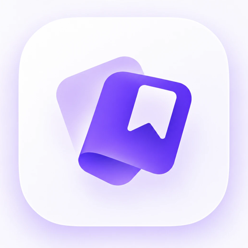

  <picture>
    <source media="(prefers-color-scheme: dark)" srcset="docs/assets/logo-dark.png">
    
  </picture>

<h1 align="center">ClipSave</h1>

**A free, open-source video downloader for Android with a share-sheet workflow — no ads, no analytics, no
trackers.** Share a link from Instagram, Facebook, YouTube, TikTok, X, Vimeo, Reddit… to ClipSave (or paste it
on the Home screen), pick a quality, and it downloads in the background to `Movies/ClipSave` (`Music/ClipSave`
for audio), or to a folder you choose. Powered by [yt-dlp](https://github.com/yt-dlp/yt-dlp), so it supports
1000+ sites.

> **Legal:** only download content you own or have permission to save. Copyright law and platform terms of
> service may restrict downloading, and you alone are responsible for what you save and how you use ClipSave.
> It is provided without warranty and is not affiliated with any service it can download from. Read the
> [Terms of Use and Disclaimer](TERMS.md); you agree to them on first launch (also in Settings → Other → Terms).

## Features

* **Share or paste** — `Share → ClipSave` from any app, or paste a link on Home (a link copied elsewhere is
  picked up automatically when the app opens).
* **Quality sheet** — Video/Audio switch, up to four qualities with sizes, editable file name. Set
  **Settings → Quality** to a fixed default (Best, 1080p, 720p, 480p, MP3) for one-tap downloads that skip the
  sheet; **Ask** (default) always shows it.
* **YouTube playlists** — a link with `list=` opens a playlist sheet: folder name, numbering (1→N, N→1, none)
  and one quality cap. Videos download one after another into `<download folder>/<playlist name>/`;
  **Downloads → Playlists** groups them per playlist.
* **Background downloads** — foreground service with a progress notification (Cancel action); survives leaving
  the app.
* **Pause / resume** — per download, per playlist, or **Pause all / Resume all**; partial files are kept, so
  resuming continues where it stopped. Failed or canceled items can be retried.
* **Your folder** — save to the default folder or pick any folder with the system picker; no storage permission.
* **Private by design** — Wi-Fi only switch, light/dark/system theme, optional Instagram/Facebook sign-in that
  stores session cookies only, never your password.

## Install

Download the latest APK from [**Releases**](https://github.com/sahedulislamrony/ClipSave/releases/latest):

| File | For |
|---|---|
| `ClipSave-<version>-arm64-v8a.apk` | almost every phone from the last ~8 years — **start here** |
| `ClipSave-<version>-armeabi-v7a.apk` | older 32-bit phones |
| `ClipSave-<version>-x86_64.apk` | emulators, Chromebooks |
| `ClipSave-<version>-universal.apk` | works everywhere, about 3× larger |

Open the file and allow "install from this source" when Android asks. You can also add the repository URL to
[Obtainium](https://obtainium.imranr.dev/) to get updates automatically.

**Verify it** (optional): compare the file against `SHA256SUMS.txt` on the release page, and check that the
signing certificate matches the one in [SECURITY.md](SECURITY.md#verifying-a-download).

ClipSave is not on Google Play: Play's policies don't allow apps that download from sites like YouTube, or that
fetch executable code outside Play (yt-dlp updates).

## Documentation

| | |
|---|---|
| [Setup and development](SETUP.md) | build from source, run, test, signed release builds, project layout |
| [Architecture](docs/architecture.md) | app flow, download states, storage and recovery |
| [Branching and releasing](docs/releasing.md) | the dev → main flow, checks, and how a release is published |
| [Design system](docs/design-system/README.md) | UI rules and components |
| [Terms of Use](TERMS.md) | what you agree to by using ClipSave |
| [Changelog](CHANGELOG.md) | what changed in each version |

## Good to know

* If a site stops working, open **Settings → Other → Check for updates**. If it still fails, report it to
  [yt-dlp](https://github.com/yt-dlp/yt-dlp/issues), which does the extraction.
* Many Instagram/Facebook posts need you to be signed in (**Settings → Accounts**). Only session cookies are
  stored on your device, never your password.

## Contributing

Bug reports, ideas and pull requests are welcome. Work happens on branches named `<username>/<topic>` and goes
into `dev` by pull request; `main` only receives tested releases. See [CONTRIBUTING.md](CONTRIBUTING.md) and the
[Code of Conduct](CODE_OF_CONDUCT.md). Report security issues privately as described in
[SECURITY.md](SECURITY.md); rights-holder notices are covered in [TERMS.md](TERMS.md#5-notices-from-rights-holders). Changes are tracked in [CHANGELOG.md](CHANGELOG.md).

## License

ClipSave is free software, licensed under the [GNU General Public License v3.0 or later](LICENSE) — the same
license as [youtubedl-android](https://github.com/junkfood02/youtubedl-android), which it is built on.
You may use, study, share and modify it under those terms, and use is subject to the [Terms of Use](TERMS.md). See
[THIRD_PARTY_NOTICES.md](THIRD_PARTY_NOTICES.md) for bundled software and their licenses.

## Acknowledgements

[yt-dlp](https://github.com/yt-dlp/yt-dlp) and its contributors do the heavy lifting;
[youtubedl-android](https://github.com/junkfood02/youtubedl-android) makes it run on Android;
[FFmpeg](https://ffmpeg.org/), [Jetpack Compose](https://developer.android.com/jetpack/compose),
[Coil](https://github.com/coil-kt/coil) and [Haze](https://github.com/chrisbanes/haze) complete the stack.
